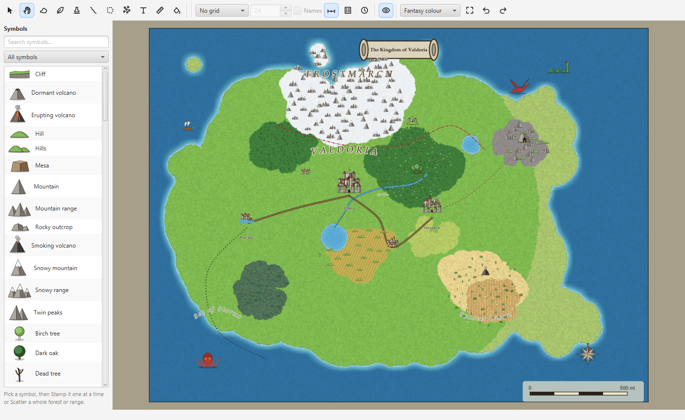
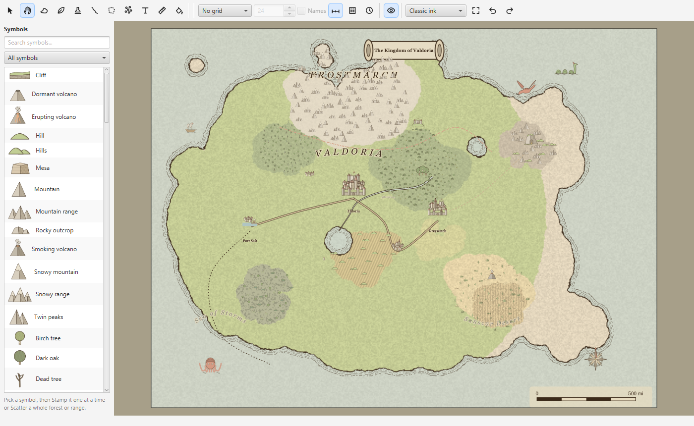
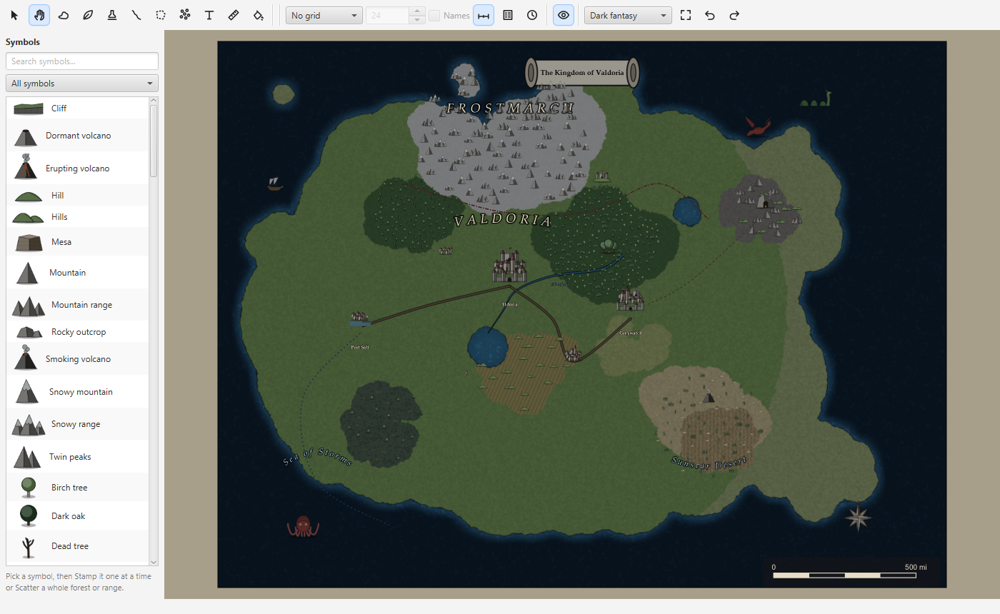
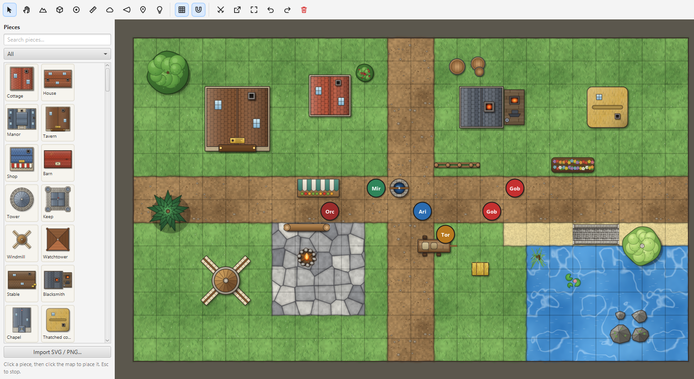
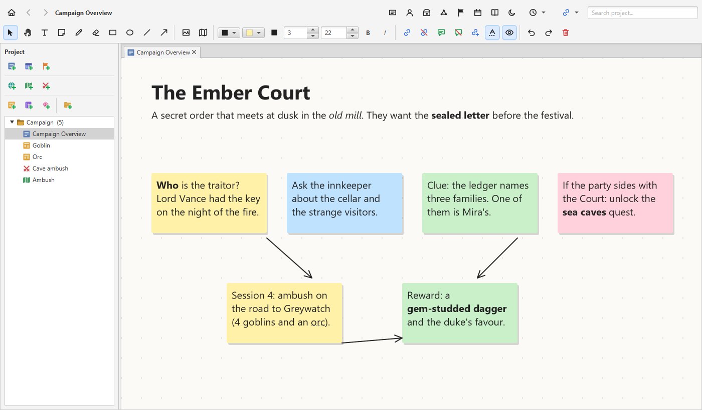
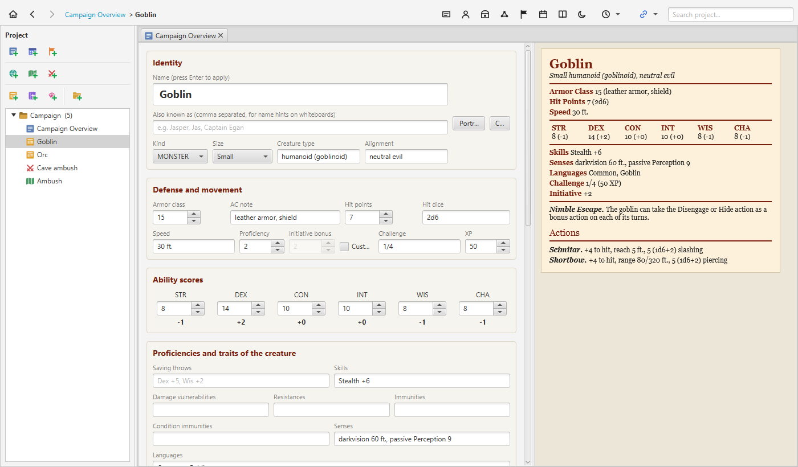
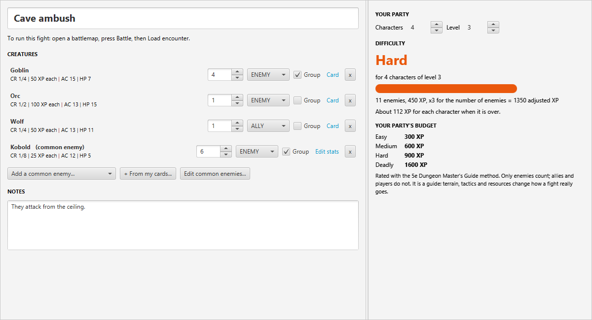
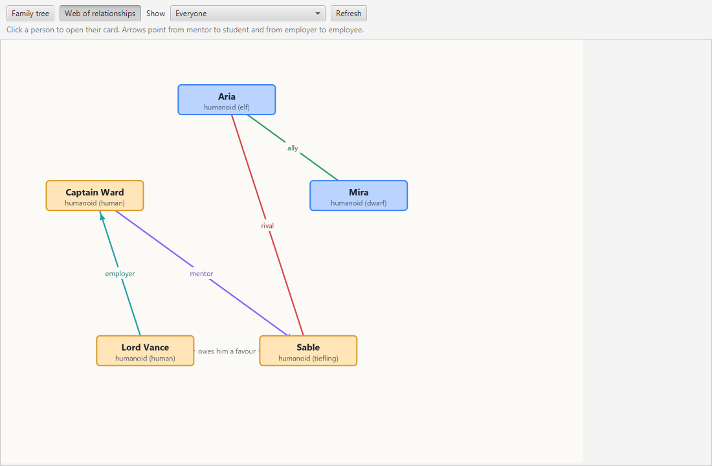

# Campaign Pocketbook

**A free, offline notebook and map maker for running tabletop RPG campaigns.** Whiteboards, battlemaps, a world map builder, character and monster cards, spells, quests, session logs and generators, all linked together in one project that is saved as plain files on your computer.



## What it does

- **World maps:** paint land, sea, lava and ice, then biomes (grass, sand, snow, swamp...); add mountains, forests, towns, ships and sea monsters from a library of about 100 symbols, each in **five art styles** (classic ink, watercolour, fantasy colour, retro pixel, dark fantasy). Draw rivers, roads and borders, write labels that follow a curve, lay a hex or square grid over the map, measure journeys in travel days, and link any place to your notes.
- **Whiteboards:** text, sticky notes, drawings, curved arrows and images, with links and hover previews.
- **Battlemaps:** square or hex grids, fog of war, dynamic lighting, tokens and a battle tracker.
- **Cards and rules:** characters and monsters as 5e-style stat blocks, spells, magic items, quests, session logs, encounters with difficulty, a family tree and relationship web, and an SRD monster and spell library.
- **Generators:** names, NPCs and loot.
- **Everything is connected:** link any item to any other, hover to preview, see what links to what, and search the whole project.
- **Yours to keep:** plain files in a folder you can copy, automatic safety copies, backup of a whole campaign to one file, dark mode.

The same kind of world map in two of the five art styles:

| Classic ink | Dark fantasy |
|---|---|
|  |  |

## A tour

**Battlemaps:** square or hex grids, terrain painting, over 150 drawn pieces, tokens, fog of war and lighting, and a battle tracker for running the fight.



**Whiteboards:** free-form notes with rich text, sticky notes, arrows and images, where any words can link to a card, map or another board.



**Cards:** characters and monsters as 5e-style stat blocks, next to the stat block as it will be read at the table.



**Encounters:** pick creatures (or your own cards) and see how hard the fight is for your party, then load it straight into a battle.



**Relationships:** a family tree and a web of who knows, serves or hates whom, built from the links between your cards.



Built with Java 21 and JavaFX. Runs on Windows, macOS and Linux; you need [Java 21 or newer](https://adoptium.net/) installed. About 26,000 lines of Java with over 300 automated tests and continuous integration.

## Download and run

**Requirement: Java 21 or newer** (64-bit). That is the only thing you need to install, and only if you do not already have it (check by typing `java -version` in a terminal; it should say 21 or higher).

How to install Java, step by step:
1. Open **[adoptium.net](https://adoptium.net/)** and press the big download button. It offers **Temurin 21 (LTS)** for your computer; if it offers a different version, pick **21** (any newer one is fine too).
2. Choose your operating system and the **x64** build (on a Mac with an M1/M2/M3 chip choose **aarch64**). Either the **JRE** or the **JDK** works; the JRE is smaller.
3. Run the installer it downloads (`.msi` on Windows, `.pkg` on macOS) and accept the defaults. If you are given the option, tick **"Set JAVA_HOME"** and **"Add to PATH"**.
4. You do not need Maven or anything else to use the download below. Maven is only for building the app from the source code.

### Easiest: download a ready-to-run zip
1. Go to the **[latest release](https://github.com/Mykkey/Campaign-Pocketbook/releases/latest)** and download the zip for your system (Windows, macOS on Apple silicon, or Linux).
2. Unzip it anywhere.
3. Start it: on **Windows** double-click **`CampaignPocketbook.bat`** (tip: right-click it and choose *Send to > Desktop (create shortcut)* for a desktop icon); on **macOS / Linux** run `./CampaignPocketbook.sh` in a terminal.

To update, download the newer zip and unzip it over (or next to) the old folder. Your campaigns live in `~/CampaignPocketbook/`, outside the app folder, so they are never touched. The app also shows a banner when a newer version is published.

### Or run it from the source code
This needs [Git](https://git-scm.com/), a Java JDK 21+ ([Adoptium](https://adoptium.net/)) and [Apache Maven](https://maven.apache.org/download.cgi) 3.9+ (JavaFX is downloaded automatically by Maven). On an Intel Mac this is the way to run it.
```
git clone https://github.com/Mykkey/Campaign-Pocketbook.git
cd Campaign-Pocketbook
mvn javafx:run
```
On Windows you can instead double-click **`CampaignPocketbook.bat`** in the project folder. The first launch takes a minute while Maven downloads dependencies; after that it starts quickly and rebuilds itself whenever the source has changed. To update, double-click **`update.bat`** (or run `git pull`).

## Learn more

- **[User guide](docs/GUIDE.md):** every feature explained, keyboard shortcuts, backups, and notes for developers.
- Your campaigns are saved in `~/CampaignPocketbook/` as plain files, so you can back them up or move them by copying a folder.

## For developers

```
mvn test           # run the unit tests
mvn javafx:run     # run the app
```

Source is in `src/main/java/dnd/` (`model`, `storage`, `ui`, `map`, `search`, `names`, `update`). The world map symbols are generated by small Python scripts in `tools/world-assets/`; see the [guide](docs/GUIDE.md#for-developers) for the branch and versioning conventions.

## License and credits

Released under the [MIT License](LICENSE). The example creature cards, and any monsters and spells you import into the library, use content from the System Reference Document 5.1 by Wizards of the Coast, licensed under [Creative Commons Attribution 4.0](https://creativecommons.org/licenses/by/4.0/). This app is not affiliated with or endorsed by Wizards of the Coast.
